# MaaSSpec

Provenance-first spectrometer for malware samples, sandbox reports, and public malware-feed records.
One input in, one spectrum out. Findings stay proposals until a person accepts them.

Built to sit beside [NocTORnal](https://github.com/dboudreau00/NocTORnal). NocTORnal keeps the case,
the graph, and the custody chain. MaaSSpec does not.

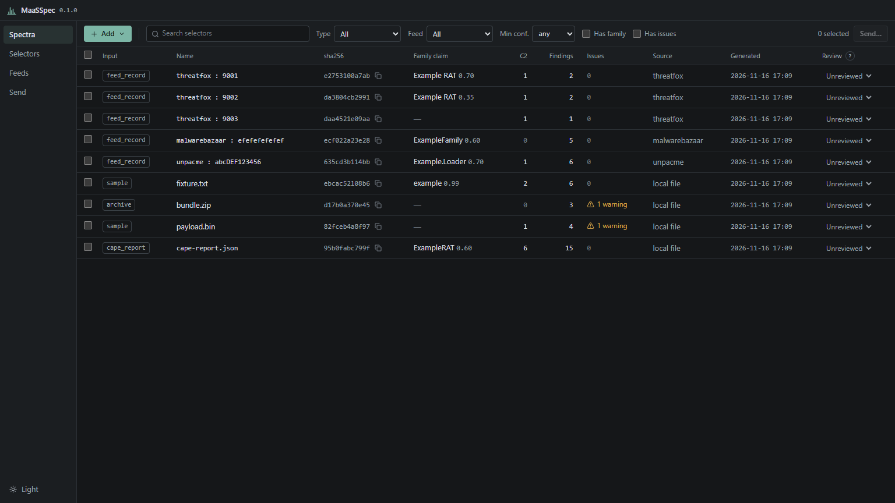

**0.1.0 is the framework.** The static scan, the spectrum schema, the CAPE normalizer (including CAPE's
own parser output), three public-feed adapters (MalwareBazaar, ThreatFox, UnpacMe), the NocTORnal ingest
client, a local web UI, and the family-plugin contract run. The only family module is a synthetic marker
used to prove that contract. It does not identify a real family.

## Screens

The screenshots use synthetic data.

### Spectra

The list at the top of this page: one row per spectrum, from local files and from feeds. Review marks
(Unreviewed, Reviewed, Skip) are kept in the browser only and are never sent.

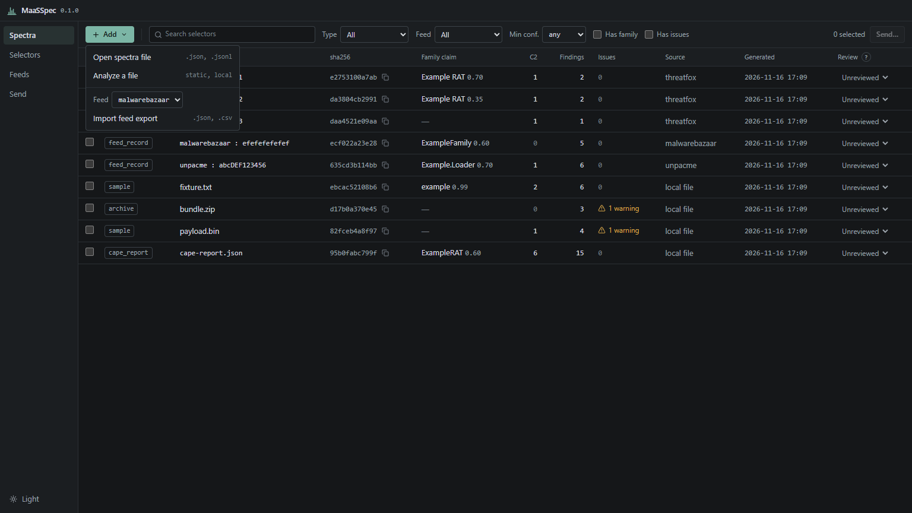

Add: open a spectra file, analyze a file (static, local), or import a saved feed export.

### Reading a spectrum

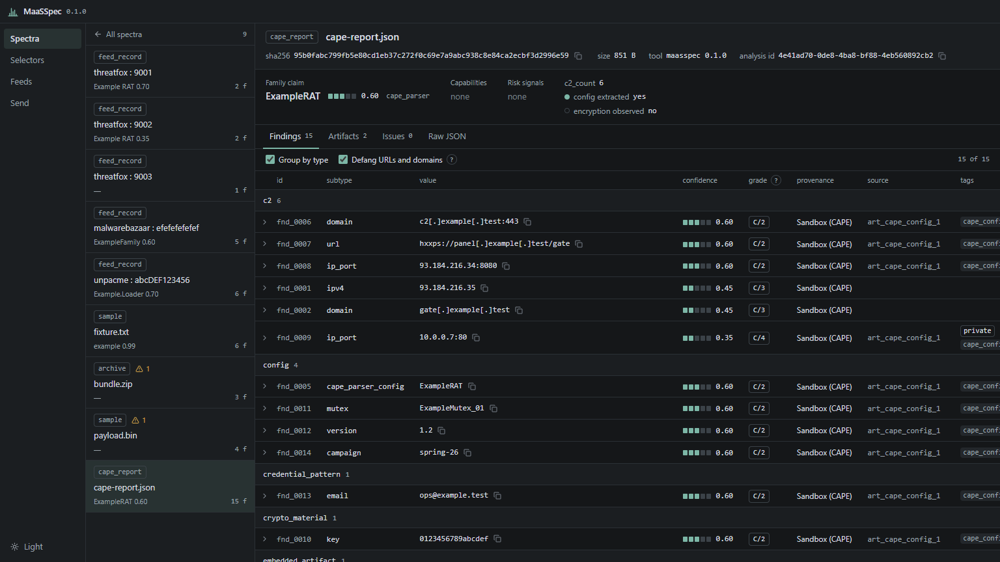

A CAPE report. The family claim comes from CAPE's parser, and findings are grouped by type with
confidence, grade, and provenance. URLs and domains are defanged by default and are never links.

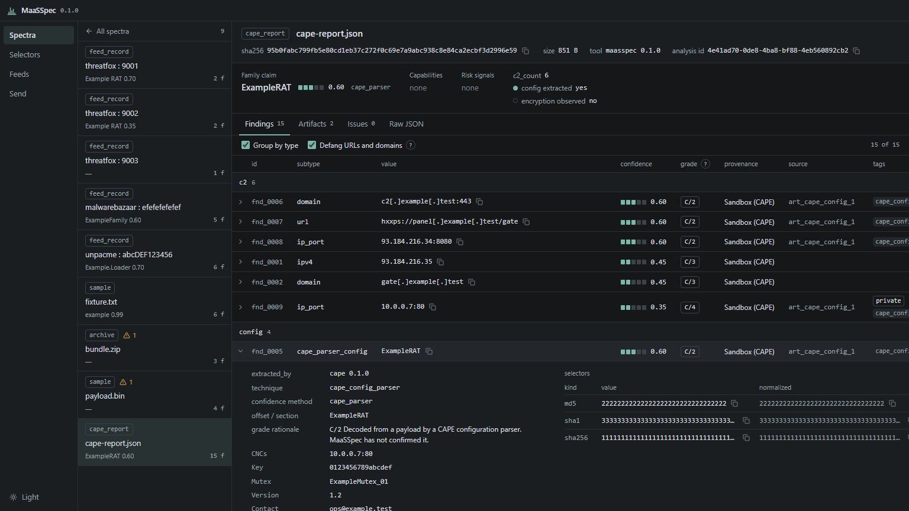

A finding expanded: module, technique, confidence method, source, grade rationale, and selectors.

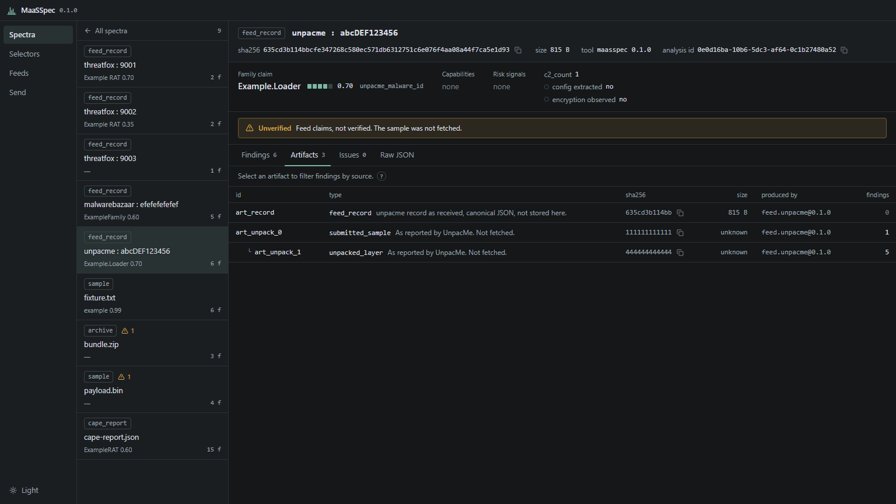

Artifacts: the submitted sample and its unpacked layer, as UnpacMe reported them. Nothing is fetched.

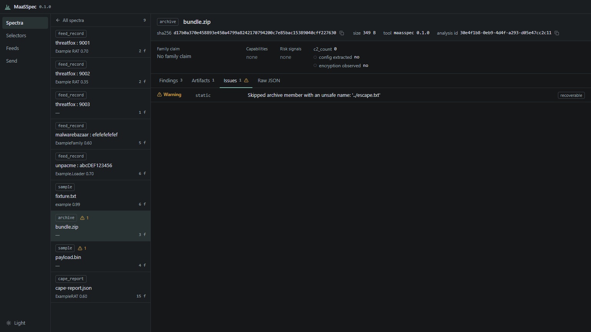

Issues: an archive member with an unsafe name is skipped and reported.

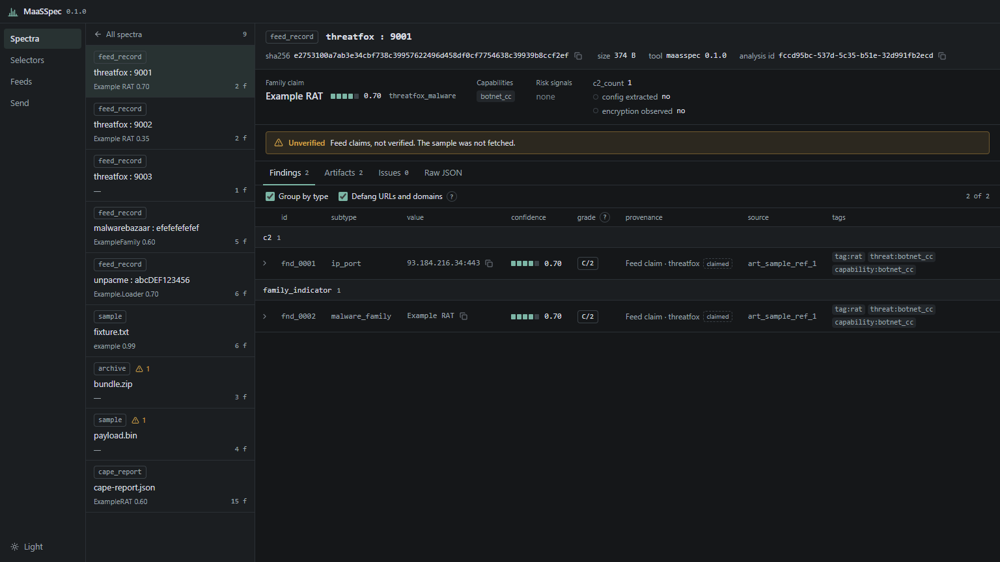

A feed record. Feed findings carry the claimed marker, and the banner says the sample was not fetched.

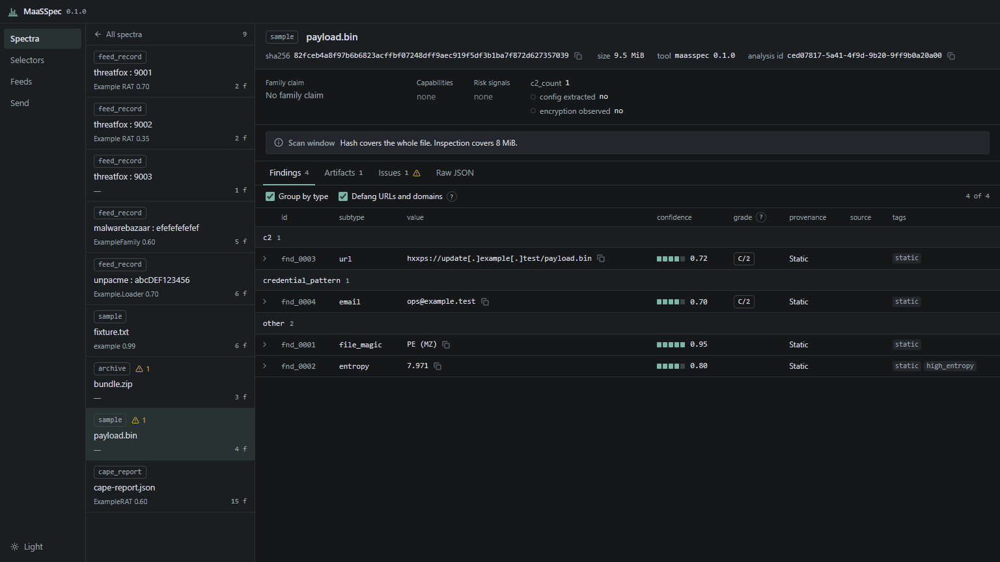

A file larger than the scan window: the hash covers the whole file, inspection covers 8 MiB.

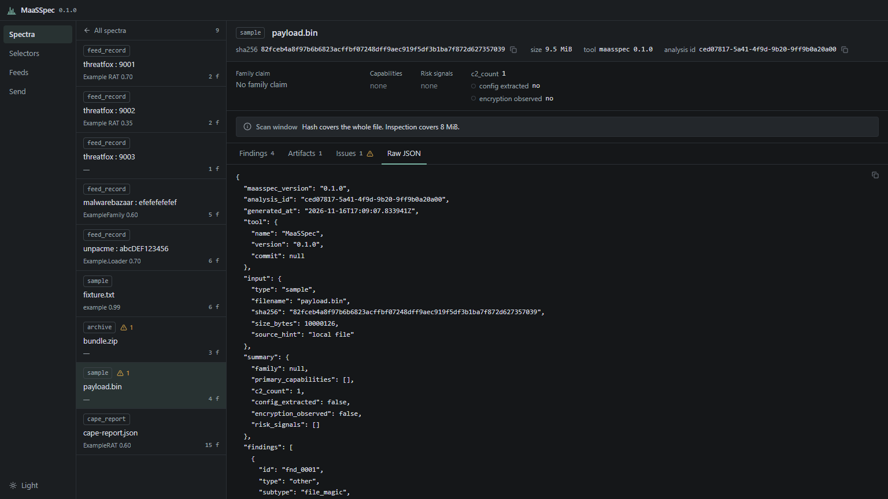

Raw JSON: the exact spectrum.

### Selectors

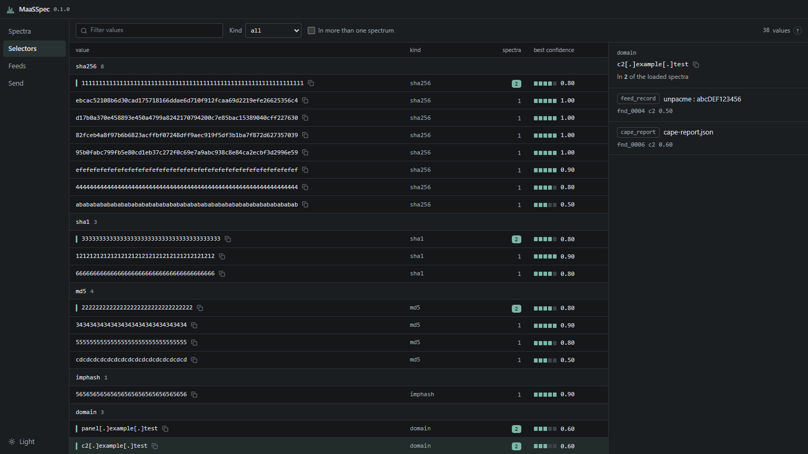

Every hash, host, and URL across the loaded spectra, and the spectra each one appears in.

### Feeds

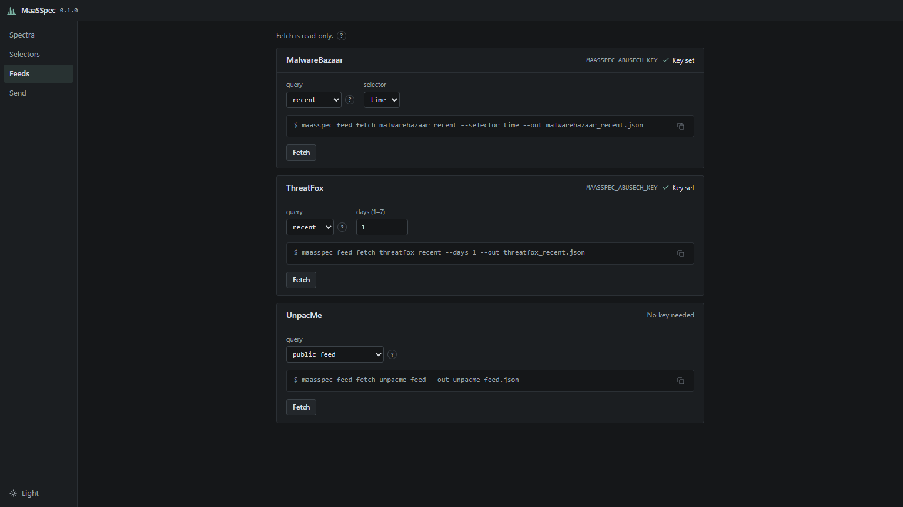

One read-only query per card. Key state is shown by variable name, never by value. The command under each
card is the CLI equivalent.

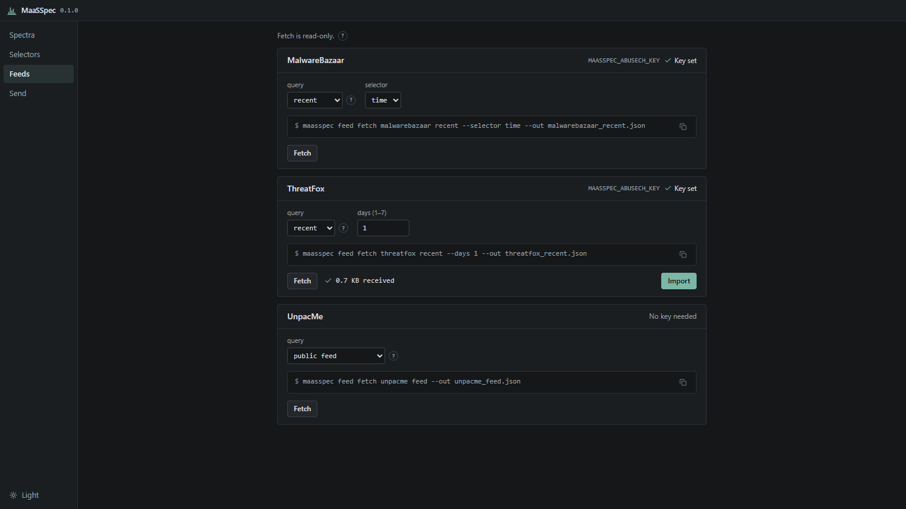

After a fetch: the size received, and Import.

### Send

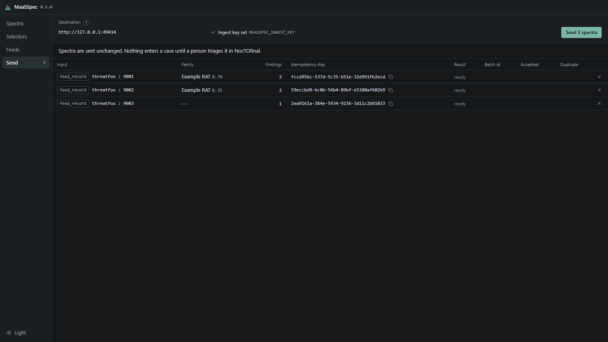

The destination comes from `MAASSPEC_NOCTORNAL_URL`. Each spectrum goes in its own request with its
analysis id as the Idempotency-Key.

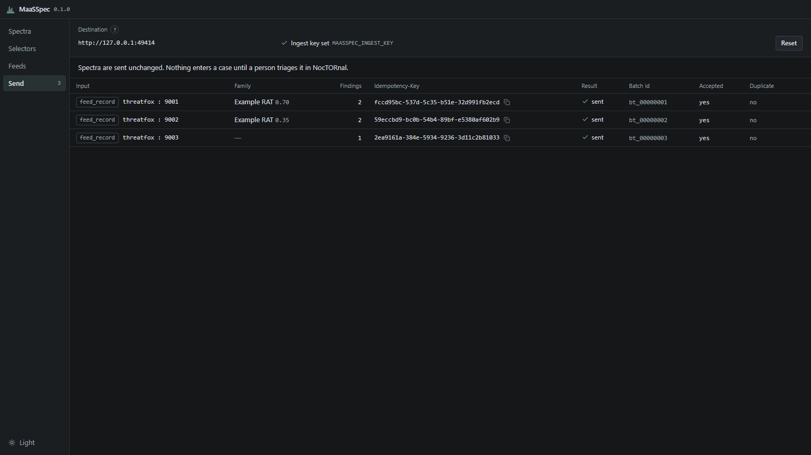

Sent: batch id and accepted, per spectrum.

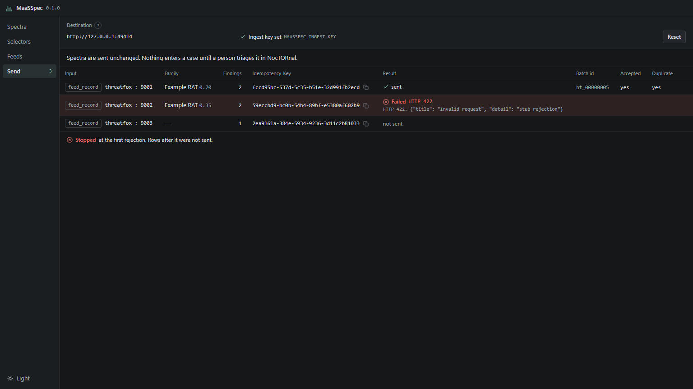

A rejection stops the run. Rows after it are not sent.

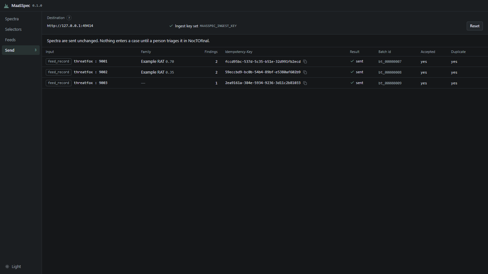

Sending the same spectra again is reported as duplicates, because a feed record's Idempotency-Key is
derived from the record.

### Themes and phones

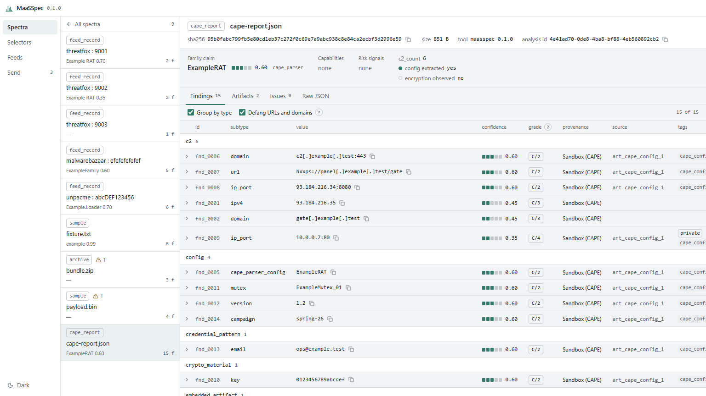

Light theme.

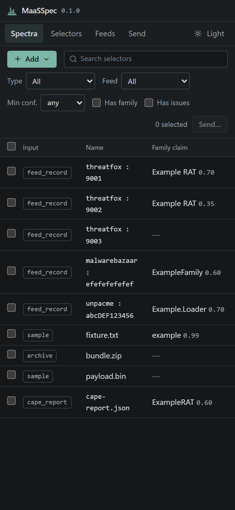

Phone width.

## Not in this tree

- Sample execution, or a sandbox of our own.
- Live C2.
- Sample downloads or uploads. Feeds are queried for metadata only.
- Graph writes. The ingest client only `POST`s raw bytes to `/api/v1/ingest`.
- Extractor code. Custom extractors are CAPE parsers that run in CAPE; MaaSSpec reads what they produce.

## Layout

```text
schema/spectrum.schema.json       generated from the pydantic models
src/maasspec/models.py            the contract
src/maasspec/engine.py            hash, scan, run modules, seal findings; feed records
src/maasspec/net.py               the only outbound HTTP (allowlist, HTTPS, no redirects)
src/maasspec/modules/             static scan, CAPE normalizer and CAPE configs, example family
src/maasspec/feeds/               MalwareBazaar, ThreatFox, UnpacMe adapters
src/maasspec/ingest/noctornal.py  raw-bytes POST to NocTORnal
src/maasspec/stream.py            bounded input, JSON Lines spectrum streams
src/maasspec/serve.py             loopback web API for the UI
ui/design/                        exported design source (reference)
ui/app/                           the web UI (React, Vite, Tailwind)
docs/images/                      README screenshots
tests/                            synthetic fixtures only, no live calls
```

## Run

Python 3.12+.

```bash
python -m venv .venv
.venv/bin/pip install -e . pytest      # Windows: .venv\Scripts\pip
.venv/bin/python -m maasspec analyze path/to/file --out spectrum.json
.venv/bin/python -m maasspec validate spectrum.json
.venv/bin/python -m pytest
```

`pydantic>=2.6` is the only runtime dependency.

## Public feeds

```bash
python -m maasspec feed list
```

| feed | queries | key |
|---|---|---|
| `malwarebazaar` | `recent`, `hash`, `tag`, `signature` | `MAASSPEC_ABUSECH_KEY` |
| `threatfox` | `recent`, `hash`, `malware`, `search` | `MAASSPEC_ABUSECH_KEY` |
| `unpacme` | `feed`, `results` (public, by unpack id) | none |

An abuse.ch Auth-Key is free from https://auth.abuse.ch/. Fetching is one read-only request per command,
so mind each service's fair-use terms. A fetch writes the raw response; an import turns a saved response
or export into one spectrum per record. Both read stdin and write stdout, so they pipe:

```bash
export MAASSPEC_ABUSECH_KEY=...
export MAASSPEC_NOCTORNAL_URL=http://127.0.0.1:8000
export MAASSPEC_INGEST_KEY=noct_sk_live_...

python -m maasspec feed fetch threatfox recent --days 1 \
  | python -m maasspec feed import threatfox - \
  | python -m maasspec ingest -
```

Save the middle steps when you want to review before posting:

```bash
python -m maasspec feed fetch malwarebazaar recent > mb.json
python -m maasspec feed import malwarebazaar mb.json --limit 200 --out mb.spectra.jsonl
python -m maasspec validate mb.spectra.jsonl
python -m maasspec ingest mb.spectra.jsonl
```

`feed import` also reads UnpacMe results JSON and the MalwareBazaar and ThreatFox exports you download
yourself. Re-importing the same export sends the same `Idempotency-Key` per record. Issue the NocTORnal
ingest key with the declared category `IOC_FEED`. NocTORnal has no MaaSSpec mapper yet, so spectra wait in
its ingest queue for a person to triage.

## CAPE reports

`analyze` reads a CAPE `report.json` (up to 128 MiB, and the console's upload takes the same): network, signatures, `malfamily`, and the `CAPE`
section that CAPE's configuration parsers fill. Write custom extractors as CAPE parsers (`custom/parsers/`
on the CAPE host); their `CAPE.configs` output becomes C2, key, and identifier findings capped at 0.6.
See `SPEC.md`.

## Web UI

A local review console: open or analyze spectra, read findings with their provenance and grade, pivot on
selectors, fetch and import feeds, and send spectra to NocTORnal. It runs on your machine only and does
not execute, download, or render a sample.

```bash
npm --prefix ui/app install --ignore-scripts      # once; needs Node 20+
npm --prefix ui/app run build
python -m maasspec serve                          # prints http://127.0.0.1:8787/#t=<token>
```

Open the printed URL. The token in the fragment is required for every API call and changes on each run.
Keys stay in the environment of the `serve` process (`MAASSPEC_ABUSECH_KEY`, `MAASSPEC_NOCTORNAL_URL`,
`MAASSPEC_INGEST_KEY`); the browser only learns whether each is set. Spectra live in the server's memory
for the session. Review marks live in the browser only.

## Next module

Copy `modules/example_family.py`. Return `DraftFinding` values and, if you are willing to claim a family,
a `FamilySummary`. Register the class in `engine.default_modules`. The example family is not on the default
pipeline: pass it to `analyze_path(modules=[...])` to run it. Keep fixtures synthetic, and read
`SPEC.md` before editing.

## License

AGPL-3.0-only. See `LICENSE` and `NOTICE`.
